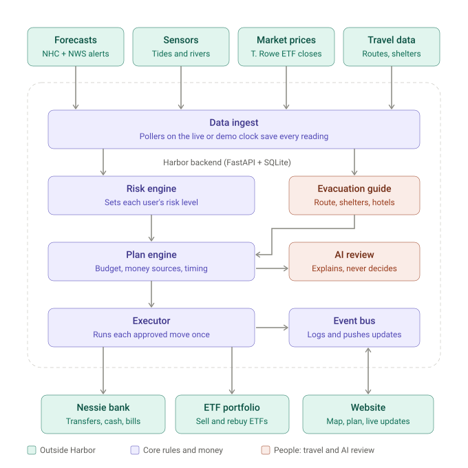

# Harbor

Harbor reads hurricane forecasts and live sensor data for your ZIP code and moves your money before
the storm arrives. It puts evacuation cash in checking, sells investments early enough to settle,
plans a safe route and a place to stay that suits your household, and moves everything back once
the storm has really passed.

One in four Americans say they couldn't afford to evacuate, and after landfall, banks and ATMs
can go down. Harbor uses the days of warning a forecast gives you so money is never the reason
someone stays in harm's way.

**Rules decide, you approve, AI explains, real sensors keep you safe.**



## How it works

1. **Watch.** Harbor follows the National Hurricane Center's forecast for your home (cone, track,
   wind probabilities, arrival times, NWS alerts) and nearby tide gauges, river gauges and buoys.
2. **Plan.** When the risk rises, a rules engine builds an evacuation budget (lodging, fuel, food,
   pets, supplies) and works out where the money comes from: checking first, then savings, then
   only the ETF shares needed, timed so the sale settles (T+1) before you need it.
3. **Approve.** An AI review explains the plan as a suggestion. Nothing moves until you approve,
   and every ETF sale needs its own tap.
4. **Act.** Money moves through the Capital One Nessie API: savings to checking, a cash withdrawal
   before ATMs go down, and a bill due during the storm moved to after it. The evacuation guide
   gives a route outside the forecast cone, shelters and hotels that fit your household, and when
   to leave.
5. **Recover.** Money moves freeze during landfall. Recovery waits until the sensors say it's safe
   (rivers falling, surge gone), not just until the forecast alerts end. Then unspent money goes
   back to savings and, if you opted in, sold ETFs are bought back.

## Hackathon tracks

| Track | How Harbor uses it |
|---|---|
| STR "Sensors for Good" | Real NOAA tide gauges, USGS river gauges and NDBC buoys guard people's safety. Harbor freezes money moves when winds arrive, warns about dangerous water levels, and won't call the all-clear while rivers are still in flood, even after the forecast alerts end. The evacuation guide covers the route, pet-friendly and special-needs shelters, and checklists for kids, older adults and medical needs. |
| Capital One "Best Use of Nessie" | Nessie is the bank: transfers from savings to checking, a cash withdrawal before landfall, the deposit when an ETF sale settles, a "bill shield" that moves a bill due during the storm, and the restore afterwards. Every write is tagged and reconciled so money is never sent twice. |
| T. Rowe Price "NextGen Finance" | Harbor sells only the T. Rowe Price ETF shares needed, early enough to settle (T+1), choosing tax lots to keep gains low and warning about wash sales. The AI review explains each move as a suggestion and never decides; a validator stops it from quoting any number that isn't in the plan, and you approve every sale. |

## Demo

The demo replays **Hurricane Milton (October 2024)** with the real NHC advisories, NWS alerts,
tide and river gauge readings and ETF prices, on a fast clock. Two fictional personas:

- **Maria** (Tampa, 33602): two adults, a child and a dog, with a car.
- **Ruth** (Sarasota, 34236): two seniors in a mobile home, no car, one on home oxygen.

## Quick start (backend)

```powershell
cd backend
python -m venv .venv
.venv\Scripts\Activate.ps1
pip install -e ".[dev]"
Copy-Item .env.example .env      # set NESSIE_MODE=fake to run without a Nessie key
uvicorn harbor.main:app --reload --workers 1
```

Open http://localhost:8000/docs for the interactive API. Run the tests with `pytest`.
Details, including deployment, are in [backend/README.md](backend/README.md).

## Project layout

```
backend/
  harbor/            FastAPI app
    engine/          risk levels, trading calendar, plan builder (pure rules)
    evac/            destinations, routes, shelters, lodging, ATMs, household needs
    sources/         forecast replay, sensors, ETF prices
    bank/            Nessie client and an offline stand-in
    ai/              plan review and explanations, with number guardrails
    api/             HTTP endpoints
  data/              recorded Milton replay, sensors, prices and evacuation data
  tools/             scripts that build that data, plus checks
  tests/             pytest suite
docs/
  DESIGN.md          system design, data sources and decisions
  API.md             API contract for the frontend (+ openapi.json)
  ROADMAP.md         build plan and demo script
  diagrams/          architecture, risk levels, Milton timeline
```

## Stack

Python 3.11+, FastAPI, SQLModel/SQLite, APScheduler, Shapely, httpx and the Anthropic SDK on the
backend; Next.js on the frontend. Data: NOAA NHC, NWS, NOAA CO-OPS, NOAA NDBC, USGS, OpenStreetMap,
GSA per diem, Capital One Nessie.
