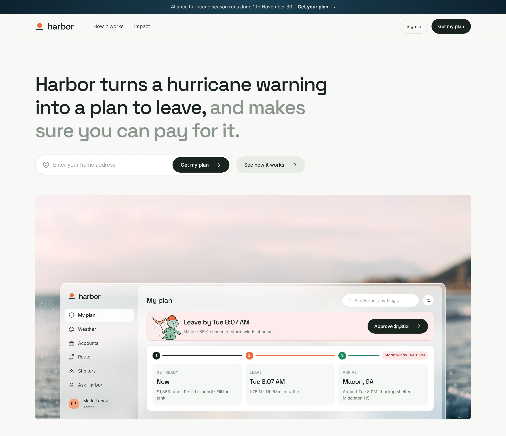
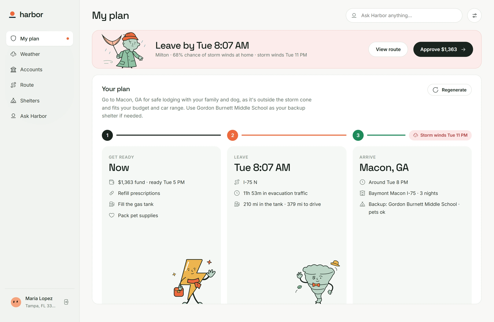
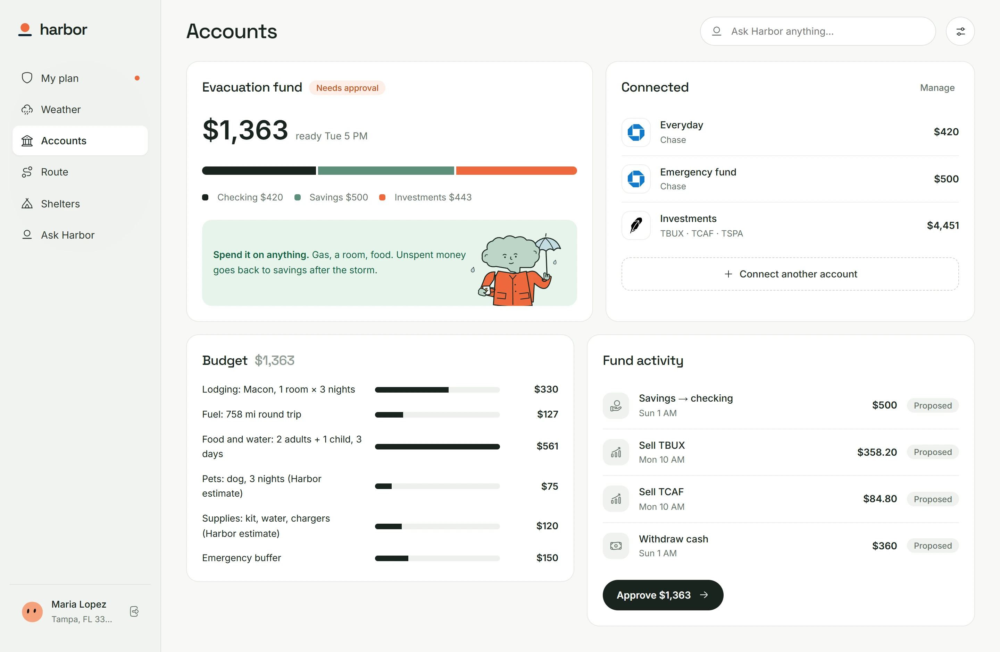
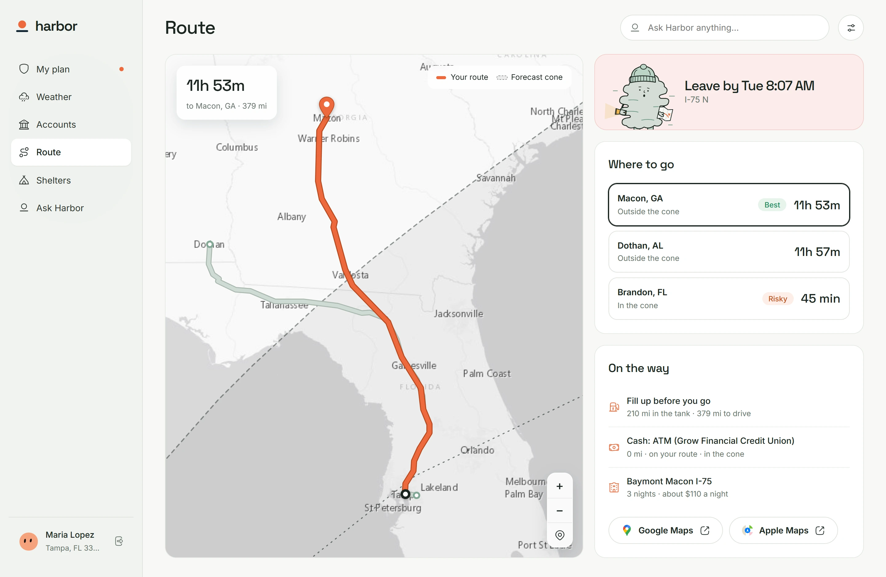
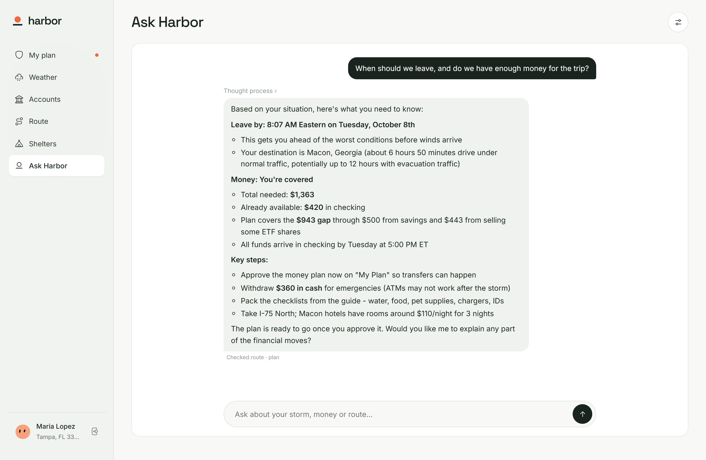
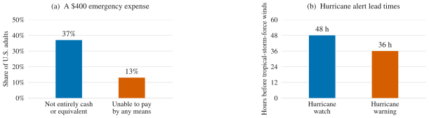
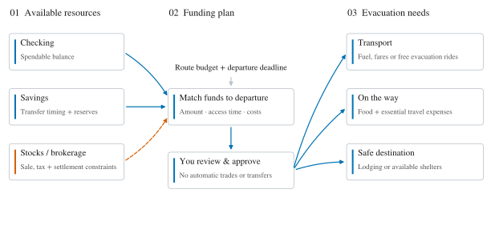
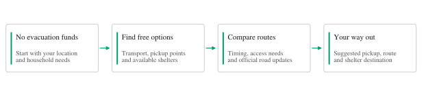
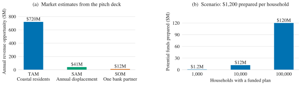

<p align="center">
  
</p>

<h1 align="center">Harbor</h1>
<p align="center"><strong>Evacuation cash, ready before landfall.</strong></p>
<p align="center"><a href="https://mattloveswaffles.github.io/harbor/">Live site</a> · <a href="docs/Harbor.pptx">Pitch deck</a></p>

## Our goal

Help households afford to leave before a hurricane hits. Harbor watches the forecast for your home, plans your route, and lines up the money for the trip so you can approve it in one tap.

## See it

**1. Start with your address.** Harbor watches the forecast for your home.



**2. Know when to leave.** My plan shows when to go, where to stay and what to do first, written by Harbor's AI from your real data.



**3. Fund the trip.** Harbor lines up the money from your accounts through Nessie. You approve it in one tap.



**4. Take the safest route.** Destinations outside the forecast cone, with fuel, cash and a room on the way.



**5. Ask anything.** Ask Harbor answers from your own plan, accounts and storm.



## Why it matters

**Money can be hard to access. Time to prepare is short.**

<p align="center">
  <picture>
    <source media="(prefers-color-scheme: dark)" srcset="assets/motivation-dark.svg">
    
  </picture>
</p>
<p align="center"><sub>Federal Reserve, 2024 SHED; NOAA/NHC. The 13% is included in the 37%. Cash equivalent includes a card paid off next statement. Alert timing refers to wind onset, not landfall.</sub></p>

## From your accounts to a way out

**Match available money to the cost and timing of leaving.** Bring checking, savings, and eligible investments into a proposed funding plan for transport, essentials, and shelter.

<p align="center">
  <picture>
    <source media="(prefers-color-scheme: dark)" srcset="assets/funding-map-dark.svg">
    
  </picture>
</p>

## No money? Still a way out.

**Find the best available free route for your household.** Harbor would compare evacuation transport, pickup points, and shelter availability against your location, timing, and accessibility needs.

<p align="center">
  <picture>
    <source media="(prefers-color-scheme: dark)" srcset="assets/no-funds-dark.svg">
    
  </picture>
</p>

Proposed routing support, subject to live availability and official evacuation guidance.

## The potential

**A bank-funded model with household readiness at its core.** The deck estimates a 60 million-person coastal market at $1 per customer per month, paid by banks.

<p align="center">
  <picture>
    <source media="(prefers-color-scheme: dark)" srcset="assets/market-impact-dark.svg">
    
  </picture>
</p>
<p align="center"><sub>Market figures are Harbor estimates, not validated demand. Impact is an illustrative $1,200-per-household scenario, not money provided by Harbor, savings generated, or proven outcomes.</sub></p>

## What's in the repo

| | |
|---|---|
| `app/` | The website and app: React, React Router, TypeScript, built with Bun. Address search covers the whole US. |
| `server/` | The API: Python, FastAPI and SQLite, managed with uv. Replays Hurricane Milton from real NOAA data, plans the money with a rules engine, connects banks and wallets and moves money through Capital One's Nessie sandbox, and runs its AI agents (Ask Harbor, and the evacuation plan as forced JSON) on OpenRouter through Pydantic AI. |
| `docs/` | The pitch deck. |

The server serves the built app next to the API, so one process runs everything.

## Run it

Needs [uv](https://docs.astral.sh/uv/) and [Bun](https://bun.sh), or just Docker.

```sh
make install          # server and app dependencies
cp .env.example .env  # NESSIE_API_KEY for the bank, OPENROUTER_API_KEY for the AI
make dev              # http://localhost:8000, rebuilding the app on save
```

Or everything in one container: `make docker`, then open http://localhost:3000. Harbor runs normally, on real time. To see it plan for a storm, run `./seed.sh`: it creates the demo household (sign in with `demo` / `1111`), connects its bank through Nessie, starts the Hurricane Milton scenario and opens the app signed in. Run it again to reset the demo.

## Check it

```sh
make check            # ruff + pytest for the server, Biome + tsc + bun test + build for the app
```

CI runs the same two checks on every push and pull request. When both pass on `main`, the site deploys to GitHub Pages, where it calls the Harbor server hosted on our own machine. The `OPENROUTER_API_KEY` repository secret only reaches the server tests, never the published site.

## Credits

Storm data: NOAA National Hurricane Center (replayed from the public archive). Weather: Open-Meteo (CC BY 4.0). Routes: OSRM, or openrouteservice when `ORS_API_KEY` is set. Shelters: FEMA Open Shelters (Hillsborough County's Milton shelters in the replay). Maps: OpenFreeMap, Esri and © OpenStreetMap contributors. Banking: Capital One's Nessie sandbox. Icons: Hugeicons (MIT). Households in the demo are fictional.
